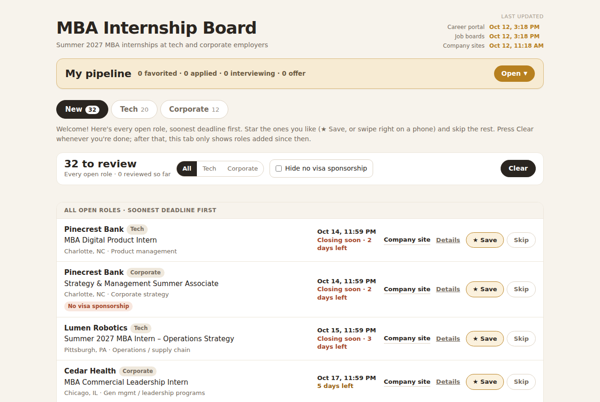
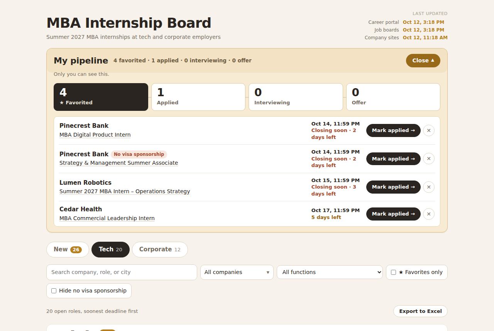
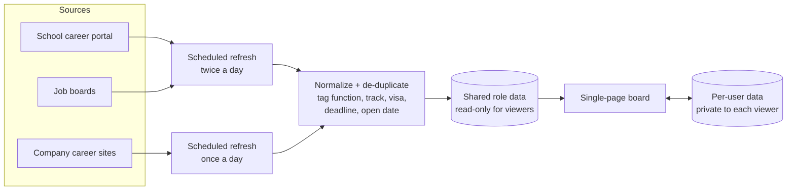
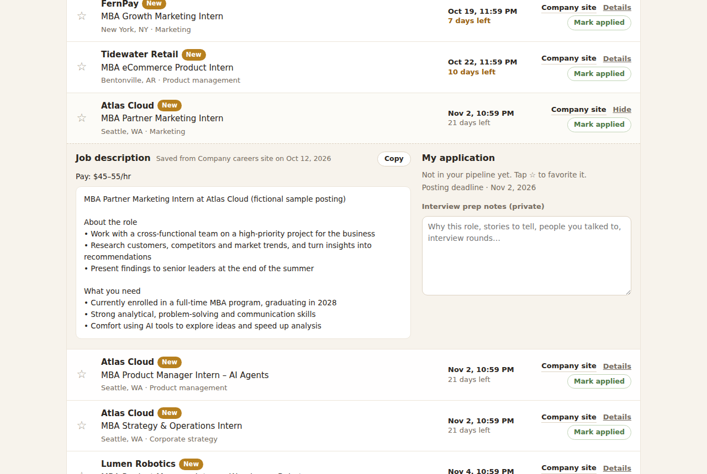
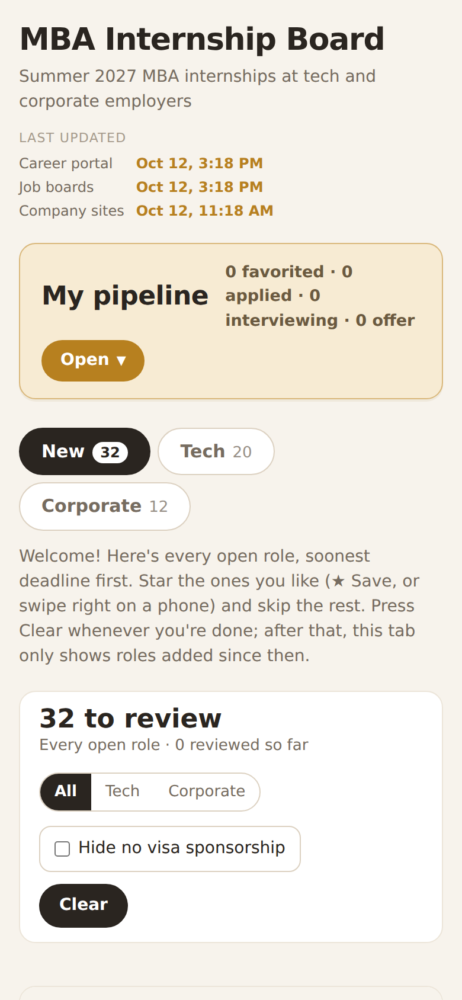

# MBA Internship Board

**A shared job board that I designed and run for my MBA classmates.** It collects Summer 2027 internships at tech and corporate employers into one list, refreshes twice a day, and gives each person a private application pipeline.

> **Live demo:** open `index.html` in a browser, or see the GitHub Pages link in the repo sidebar. The demo runs on **fictional sample data** (made-up companies, roles and links). The production version reads from private sources that aren't part of this repo.



---

## The problem

**Purpose:** give MBA students one place to find, filter and track internship postings that are otherwise scattered across many sources, focusing on **corporate and tech roles, organized by function** (product, strategy, marketing, operations, finance, general management).

During MBA internship recruiting, postings are spread across three kinds of places:

1. **The school's career portal.** It's thorough but slow to search, and it doesn't flag what's new.
2. **Job boards.** They're noisy, with many duplicates and many roles that aren't MBA-level.
3. **Company career sites.** These are often the first and only place a role appears, but checking 100+ sites by hand isn't realistic.

There was no central way to track them all, or to filter them by what each person actually cares about: function, tech vs. corporate, deadline, or visa sponsorship. Classmates were keeping their own spreadsheets, missing early deadlines, and finding roles after they had closed. The questions everyone asked each week were the same: *What's new? What closes soon? Will they sponsor my visa? Where am I with each application?*

## Who it's for

- **MBA classmates recruiting for summer internships**, mainly in product, strategy, marketing, operations and general-management roles.
- **International students**, who need to know early whether a role is open to candidates who need visa sponsorship.
- **Me.** I'm recruiting too, so I use it every day, which kept the bar high.

## What it does

| Need | Feature |
|---|---|
| "What's new since I last looked?" | A **New** tab that shows only roles added since your last visit. You Save ★ or Skip each one, and Clear when you're done. |
| "What closes soon?" | Every list is sorted soonest deadline first. Labels flag **Closing soon · N days left**, **Rolling / Apply early**, and **Opens Nov 12** for roles that are posted but not yet open. |
| "Do they sponsor visas?" | A **No visa sponsorship** tag, based on the posting's own wording, with company-level overrides where every posting says the same. One checkbox hides those roles. |
| "Where am I with each application?" | A private **pipeline** (Favorited → Applied → Interviewing → Offer) with one-click advance and undo. Applied roles are tinted in the main list. |
| "I need the description for my cover letter." | A **Details** drawer with the saved job description, pay, deadline history and private interview-prep notes, plus a **Copy** button. |
| "I want it in Excel." | **Export to Excel** downloads whatever is currently filtered as a CSV. |



## How it works



- **One page, no build step.** The board is a single HTML file with vanilla JS, about 800 lines. It runs inside a hosted runtime that provides a small document database and user identity.
- **Two data scopes:**
  - **Shared data** (roles, companies, job descriptions, visa tags, change log) can be written only by the owner's refresh jobs. Everyone else can only read it.
  - **Personal data** (statuses, favorites, notes, what you've already reviewed) lives under each viewer's own ID. A rule lets each viewer write only to their own path. A new viewer starts with an empty pipeline, and nobody can see anyone else's.
- **Scheduled refresh jobs** pull new postings, fix moved deadlines, and save each job description when it's first seen, so the description is still there after the posting comes down. The jobs only ever move a deadline *earlier*. If a source shows a later date than one we already have, we keep the earlier one, because missing a deadline costs far more than applying early.
- **Duplicates are merged** across sources, so a role posted on the career portal and on the company site appears once, with both links.

In this repo, `demo-shim.js` stands in for the hosted runtime. It provides a fake database loaded with sample roles and keeps your pipeline in `localStorage`, so the page code is the same code that runs in production.



## Decisions and trade-offs

**Posting wording beats company statistics for visa tags.** My first idea was to tag employers by their public H-1B filing counts. That turned out to be misleading. One company files dozens of H-1Bs a year, but all of them are for engineers, while its MBA internship says "no sponsorship." Tags now come from the posting text. The parser catches phrasings like *"will not pursue visa sponsorship"* and *"not a position for which sponsorship will be provided."* There are manual company-level overrides where every posting agrees. Roles with no sponsorship language are left untagged rather than guessed at.

**"Not open yet" is its own state.** Some postings are visible weeks before they accept applications. Mixing them into the list caused people to click through to a dead page, so they now sit in an **Opening soon** group at the bottom with the open date.

**Simplicity over features.** Earlier versions had event calendars, coffee-chat tracking, a contacts tab and a stats dashboard. They made the page harder to scan and weren't core to the job of finding and tracking roles. I cut them all and kept three tabs, four filters and one pipeline.

**One action system.** At first there was a ★ for interest and a ✓ for applied. I merged these into a single ★ that moves through pipeline stages, and colored applied rows green so status is visible without reading.

**The first visit is different from later visits.** A brand-new viewer has seen nothing yet, so a "new since last visit" list makes no sense. On a first visit the New tab shows *every* open role, soonest deadline first, so people can star their way through it in one pass. After that, it shows only what has been added since their last Clear.

**Privacy by default.** Before sharing the board, I locked the shared data so viewers can't change it. I checked that rule directly: a write from a non-owner account to shared data is refused. Personal data is stored per viewer.

## Iterations

The board went through **30 published versions in about three weeks** (Sept 24 to Oct 12, 2026). Most changes came from daily use, mine and classmates':

- *"I can't tell what I've applied to."* → Applied rows are now tinted. The ✓ is gone and the ★ does both jobs.
- *"Details jumps me back to the top of the page."* → Scroll position is now kept on every re-render.
- *"I want to paste the job description into my notes."* → Added a Copy button.
- *"Can I get this in a spreadsheet?"* → Added Export to Excel.
- *"Some roles aren't open yet but look open."* → Added the Opening soon group and open dates.
- *"Why are some descriptions missing?"* → Backfilled **62 job descriptions** and changed the refresh jobs to save each one the first time a role is seen.
- *"The pipeline takes up the whole screen."* → The pipeline is now collapsed by default, with a summary line.

## Results

- **~270 open roles across ~130 companies**, from 3 source types, refreshed twice a day.
- **Caught moved deadlines early.** Refresh jobs found postings whose real close dates were 1–2 weeks earlier than the career portal showed (one moved up to Oct 14), and the board flagged them before they passed.
- **62 job descriptions saved** that would otherwise have disappeared when postings closed.



## How it was built

I acted as the product owner: I defined the problem, set the requirements, ran feedback with classmates, and made every scope and design call. The build was done with **Claude**, Anthropic's AI assistant, as the engineer. Claude wrote the code and the refresh jobs, and I directed and reviewed each iteration. Working this way let me go from idea to a tool classmates use daily in a few weeks, without slowing down recruiting.

## Run the demo locally

```bash
git clone https://github.com/<your-username>/mba-internship-board.git
cd mba-internship-board
open index.html          # macOS. On Windows: start index.html
```

There's nothing to install. Your demo pipeline is saved in your browser's `localStorage`. Clear site data to start over.

## Repo contents

| File | What it is |
|---|---|
| `index.html` | The board: the same page code as production, with personal details removed |
| `demo-shim.js` | Stand-in runtime: sample data, a fake database, and local storage for your pipeline |
| `docs/` | Screenshots |

**Not included:** the live data and the refresh jobs. They read from my school's career portal and other sites under those sites' own terms, and job descriptions belong to the employers that wrote them.

## License

MIT. See [LICENSE](LICENSE).
